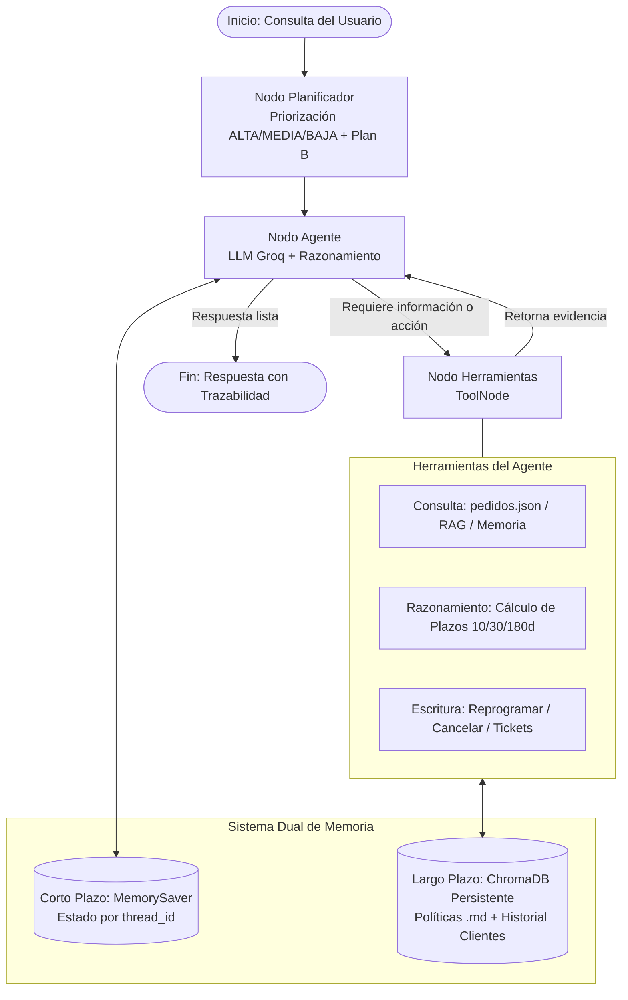

# SodiAssist v2.0 — Agente Funcional Autónomo de Postventa (Sodimac)

**SodiAssist v2.0** es un agente inteligente autónomo diseñado para automatizar la gestión de postventa de Sodimac. Evoluciona desde un flujo lineal estático hacia una arquitectura basada en **grafos de estado cíclicos (LangGraph)**, integrando planificación estratégica con prioridades, herramientas de consulta, razonamiento determinista y escritura sobre bases de datos simuladas, junto con un sistema dual de **memoria de corto y largo plazo (ChromaDB persistente)**.

Proyecto desarrollado para la Evaluación Parcial N°2 de la asignatura **Ingeniería de Soluciones con IA (`ISY0101`) — Duoc UC**.

---

## 🏗️ Arquitectura y Orquestación del Agente

La solución reemplaza los flujos rígidos (`if/else`) por una máquina de estados dirigida en **LangGraph**, compuesta por tres nodos principales y un ciclo de retroalimentación para ejecución autónoma de herramientas (*Tool Calling*):

1. **Nodo Planificador (`planificador`)**: Analiza cada requerimiento entrante mediante salida estructurada (*Pydantic*), clasifica su urgencia (`ALTA`, `MEDIA`, `BAJA`), define una secuencia ordenada de pasos y establece un criterio de adaptación (*Plan B*).
2. **Nodo Agente (`agente`)**: Evalúa el plan activo, el historial de la sesión actual y los resultados devueltos por las herramientas para decidir si invoca una nueva herramienta o entrega la respuesta final al cliente.
3. **Nodo de Herramientas (`herramientas`)**: Ejecuta de forma autónoma funciones de consulta, cálculo de reglas de negocio y mutación de datos en disco.

### Diagrama de Orquestación (LangGraph + Memoria Dual)



---

## 🛠️ Capacidades e Indicadores Implementados

### 1. Herramientas de Consulta, Razonamiento y Escritura (`src/tools.py`)
* **Consulta:**
  * `consultar_pedido`: Obtiene estado, producto, fecha de entrega e incidencias desde `data/pedidos.json`.
  * `consultar_politicas`: Recuperación semántica (RAG) sobre los documentos oficiales en `data/docs/`.
  * `consultar_memoria_cliente`: Recupera gestiones y tickets previos de un cliente en sesiones anteriores.
* **Razonamiento / Reglas de Negocio:**
  * `evaluar_elegibilidad_plazos`: Calcula los días corridos entre la fecha de entrega y la fecha operativa (`2026-09-30`), contrastando contra los plazos legales (**10 días** devolución, **30 días** cambio, **180 días** garantía) y proponiendo alternativas automáticas si un plazo expiró.
* **Escritura (Mutación de Estado):**
  * `gestionar_despacho_atrasado`: Actualiza el estado de pedidos atrasados en `data/pedidos.json` (`REPROGRAMAR` prioritario 24h o `CANCELAR` con reembolso).
  * `generar_ticket_postventa`: Crea registros trazables en `data/tickets.json` y persiste un resumen semántico en ChromaDB.

### 2. Sistema de Memoria Dual (`src/memory.py`)
* **Memoria de Corto Plazo:** Implementada con `MemorySaver` de LangGraph indexado por `thread_id`, permitiendo mantener conversaciones multi-turno sin que el usuario repita identificadores de pedido.
* **Memoria de Largo Plazo:** Implementada con `chromadb.PersistentClient` en `data/chroma_db/`, separada en dos colecciones vectoriales persistentes: `politicas_sodimac` e `historial_clientes`.

---

## 📂 Estructura del Repositorio

```text
sodiassist/
├── data/
│   ├── docs/                      # Políticas oficiales de Sodimac en Markdown
│   │   ├── politica_cambios.md
│   │   ├── politica_despachos.md
│   │   ├── politica_devoluciones.md
│   │   └── politica_garantias.md
│   ├── chroma_db/                 # Base de datos vectorial persistente (generada al ejecutar)
│   ├── pedidos.json               # Base de datos simulada de pedidos (lectura/escritura)
│   └── tickets.json               # Registro persistente de tickets generados (escritura)
├── src/
│   ├── __init__.py
│   ├── agent.py                   # Grafo LangGraph, nodo planificador y control de tasa API
│   ├── memory.py                  # Gestión de ChromaDB persistente y MemorySaver
│   └── tools.py                   # Definición de herramientas (@tool)
├── main_2.py                      # Punto de entrada: Suite de pruebas (IE7) y Chat en vivo
├── requirements.txt               # Dependencias del proyecto
└── README.md                      # Documentación técnica del repositorio
```

---

## ⚙️ Requisitos e Instalación

### Requisitos Previos
* **Python 3.10** o superior.
* Clave de API activa de **Groq** (`GROQ_API_KEY`).

### Pasos de Configuración

1. **Clonar el repositorio:**
   ```bash
   git clone <URL_DEL_REPOSITORIO>
   cd sodiassist
   ```

2. **Crear y activar el entorno virtual:**
   * **Windows (PowerShell):**
     ```powershell
     python -m venv venv
     .\venv\Scripts\activate
     ```
   * **Linux / macOS:**
     ```bash
     python3 -m venv venv
     source venv/bin/activate
     ```

3. **Instalar dependencias:**
   ```bash
   pip install -r requirements.txt
   ```

4. **Configurar la variable de entorno `GROQ_API_KEY`:**
   * **Windows (PowerShell):**
     ```powershell
     $env:GROQ_API_KEY="tu_api_key_de_groq"
     ```
   * **Linux / macOS:**
     ```bash
     export GROQ_API_KEY="tu_api_key_de_groq"
     ```

---

## 🚀 Ejecución y Pruebas del Sistema

Ejecuta el script principal:

```bash
python main_2.py
```

El sistema desplegará dos modos de operación:
* **Opción `[1]` — Suite de Pruebas Automáticas (`IE7`):** Ejecuta de manera secuencial y regulada 3 escenarios de validación:
  1. *Escenario 1:* Planificación prioritaria (`ALTA` para línea blanca atrasada), memoria de corto plazo multi-turno y escritura en `pedidos.json` y `tickets.json` (Pedido `1002`).
  2. *Escenario 2:* Razonamiento adaptativo frente a plazos legales en todos los pedidos (`1001` fuera de plazo de devolución adaptado a cambio; `1004` dentro de plazo de devolución; `1003` en tránsito no elegible aún para garantía).
  3. *Escenario 3:* Recuperación semántica de memoria de largo plazo entre sesiones distintas (`thread_id` nuevo para el cliente `CLI-01`).
* **Opción `[2]` — Chat Interactivo en Vivo:** Permite interactuar libremente con el agente ingresando un identificador de cliente para validar flujos en tiempo real.

---

## 📦 Dependencias (`requirements.txt`)

* `langgraph>=0.2.0`
* `langchain>=0.3.0`
* `langchain-core>=0.3.0`
* `langchain-groq>=0.2.0`
* `chromadb>=0.5.0`
* `pydantic>=2.0.0`